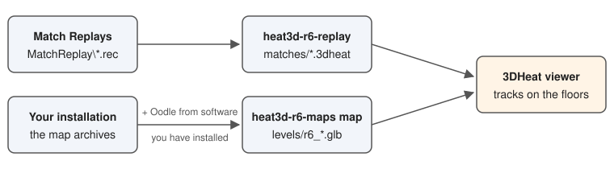

# 3DHeat R6 Maps

**What is it?** A tool that reads **your own installation** of Rainbow Six
Siege, for interoperability and personal analysis, and builds its maps as 3D
levels for the [3DHeat](https://github.com/Holdi601/3DHeat) viewer
([documentation](https://holdi601.github.io/3DHeat/)): floors, stairs and
walls, with the breakable walls, hatches and barricades as separate parts.



**Why would I use it?** To see your matches on the building, floor by floor.
The matches come from the separate replay reader,
[3DHeat R6](https://github.com/Holdi601/3DHeat-Ext-R6) (`heat3d-r6-replay`).
The viewer puts the players' tracks on the level by itself.

**Example:**

```text
heat3d-r6-maps map --all --game "<your game folder>" --out levels --oodle "<path to oo2core_9_win64.dll>"
                                            # -> levels/r6_<Map>.glb + .json
```

Then load a map's `.glb` once in the viewer (**Background / level** ->
**3D model…**); from then on the viewer picks it up by itself for matches on
that map. It stays in the viewer's local library, on this computer.

**What you need:** Python 3.10 or newer, your installation of Rainbow Six
Siege, and an Oodle library from software you have installed - see
[Before you start](before-you-start.md).

**What it never does:** start or touch the game, its anti-cheat or its memory;
change anything in the game folder; download or share game data or Oodle. See
[Terms and licence](terms.md).

**Its own project:** each game reader is its own small project with its own licence file,
releases and issue tracker, so it can be installed, updated, maintained - or
withdrawn on a rights holder's request - on its own, without affecting the
viewer or the other tools.

**Notice:** not affiliated with or endorsed by Ubisoft; trademarks belong to
their owners. The levels stay on your machine for your personal analysis: do
not share or redistribute them. Meant for non-commercial use; do not use the
output to train AI models. Rights holders: open an issue or get in touch
through the GitHub profile; we respond within 48 hours and remove on request.

## Quick start

You need Windows, Python 3.10 or later ("Add python.exe to PATH" ticked in its
installer), Rainbow Six Siege installed (you give its folder, the one holding
the game's `.forge` files, for example
`C:\Program Files (x86)\Ubisoft\Ubisoft Game Launcher\games\Tom Clancy's Rainbow Six Siege`
or `...\steamapps\common\Tom Clancy's Rainbow Six Siege`), a 64-bit `oo2core_9_win64.dll` from software you
have installed (you give its path), and about 10 GB of free disk space for a
cache; no Git. More in [Before you start](before-you-start.md).

```bash
python -m pip install https://github.com/Holdi601/3DHeat-Ext-R6-Maps/archive/refs/tags/v0.1.0.zip
heat3d-r6-maps map --list --game "<your game folder>"     # the maps your installation has
heat3d-r6-maps map --all --game "<your game folder>" --out levels --oodle "<path to oo2core_9_win64.dll>"
```

`HEAT3D_R6_GAME` and `HEAT3D_OODLE` can hold the two paths instead; `map
Clubhouse Bank ...` builds only those maps. Per map, `map` writes
`levels\r6_<Map>.glb` (the level, 30 to 70 MB) and `levels\r6_<Map>.json` in
the `--out` folder. The first run unpacks the game's archives into
`levels\.unpacked` (a few minutes, about 10 GB, resumable; `--cache <folder>`
puts it elsewhere): delete it when the levels are built ([Maps](map.md)).

Then open the `.glb` in the [3DHeat viewer](https://github.com/Holdi601/3DHeat#quick-start):
download it (**Code -> Download ZIP**, unpack), double-click `start.bat` (it
offers to install Node.js when it is missing and opens `http://127.0.0.1:5273`),
then **Background / level -> 3D model...** and pick `r6_<Map>.glb` once: the
viewer keeps it in its level library and from then on offers it for matches on
that map ([In the viewer](map.md#in-the-viewer)). The level stays on your
machine.

When a new release is out, the tool says so when it starts and offers to
update itself (`python -m heat3d_ext_r6maps.update` does the same).

## Pages

| Page | What it covers |
|---|---|
| [Before you start](before-you-start.md) | installing, the Oodle library, where the files go |
| [Maps](map.md) | building the levels, their parts, loading them in the viewer, checking them |
| [Terms and licence](terms.md) | what this tool reads, does and does not do, and writes |
| [Command reference](cli-reference.md) | every option, generated from the program |
